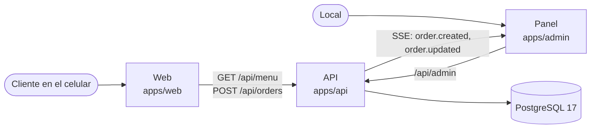
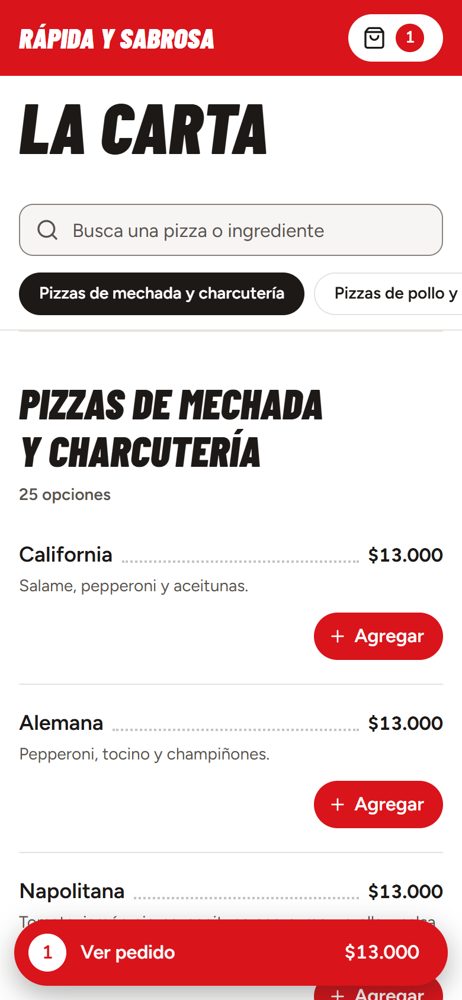
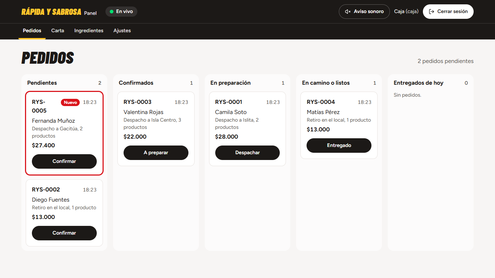

# Rápida y Sabrosa — web de pedidos

[](https://github.com/nachoLuarca/rapida-y-sabrosa-web/actions/workflows/ci.yml)

Una pizzería de Isla de Maipo deja su carta en LaCarte y pasa a recibir pedidos propios: el cliente pide desde el
celular, el pedido llega en vivo a un panel del local y el local administra ahí su carta, zonas, horario y pausa.

## Qué muestra este proyecto

- **Monorepo con npm workspaces:** tres apps (web, panel y API) y tres paquetes compartidos: `@rys/domain` (reglas
  de negocio puras), `@rys/contracts` (esquemas Zod de la API) y `@rys/tokens` (CSS de la marca). La web y la API
  calculan los precios con el mismo código.
- **API Express 5 en capas:** rutas → controladores → servicios → repositorios, con inyección por constructor y sin
  framework de DI. Un solo formato de error y documentación OpenAPI generada desde los mismos esquemas Zod.
- **PostgreSQL 17 con Drizzle:** 4 migraciones SQL versionadas en git y un seed idempotente desde `docs/data`.
- **Pedidos confiables:** el cliente envía qué quiere y el total que vio; el servidor recalcula y responde
  `PRICE_CHANGED` si no coincide. Cada pedido exige `Idempotency-Key`: un reintento con el mismo body devuelve el
  mismo pedido, y dos requests simultáneos crean uno solo. Rate limit de 10 pedidos por IP cada 10 minutos.
- **Panel con sesión en cookie:** cookie `HttpOnly` con token aleatorio (en la base solo su SHA-256), contraseñas
  con argon2id, chequeo de `Origin` contra CSRF y roles `admin` y `staff` con permisos por campo (caja solo marca
  agotados y pausa los pedidos).
- **Tiempo real con SSE:** el pedido nuevo aparece en el tablero al instante, con heartbeat cada 25 s y reconexión
  que vuelve a pedir la lista para no perder eventos.
- **632 tests:** API 244 (integración con supertest contra PostgreSQL real), dominio 127, web 110, panel 89,
  contratos 55 y scripts 7. GitHub Actions corre lint, typecheck, migraciones, tests y builds en cada push.
- **Accesibilidad y rendimiento** (revisión final, Fase 10): Lighthouse en celular de la web en modo api con
  Rendimiento 98, Accesibilidad 100, Buenas prácticas 100 y SEO 100; axe-core 4.14 sin violaciones en las siete
  pantallas del panel y en la web; recorrido completo con teclado en ambas apps.

## Stack

| Parte | Tecnología |
|---|---|
| Web | React 19, Vite 8, TypeScript estricto, Tailwind CSS 4 |
| Panel | React 19, Vite 8, TypeScript estricto, Tailwind CSS 4 (app aparte, mismos tokens de marca) |
| API | Node 24, Express 5, Zod 4, Drizzle ORM, pino, helmet, argon2id |
| Base de datos | PostgreSQL 17 en Docker Compose |
| Tests | Vitest, Testing Library con jsdom, supertest, `node:test` |
| CI | GitHub Actions con un servicio `postgres:17` |

## Cómo se conecta



## Probarlo en 2 minutos

Requisitos: Node 24 y Docker Desktop abierto. Desde la raíz del repositorio:

```
npm ci
cp apps/api/.env.example apps/api/.env    # define DEMO_PASSWORD (mínimo 10 caracteres)
npm run demo
```

`npm run demo` levanta PostgreSQL, aplica las migraciones, carga la carta y deja la web en `http://localhost:5173`
y el panel en `http://localhost:5174`, también accesibles desde un celular en la misma red Wi-Fi (muestra las URL al
terminar; puede hacer falta abrir el puerto en el Firewall de Windows, ver `docs/DEMO.md`). En modo demo los pedidos se guardan y llegan al panel, pero no se envía nada al WhatsApp del local.

Usuarios del panel (la contraseña es la de `DEMO_PASSWORD` en `apps/api/.env`):

- `admin@demo.local`: administración, edita todo.
- `caja@demo.local`: caja, gestiona pedidos, marca agotados y pausa los pedidos.

El guion completo de la demo está en `docs/DEMO.md`.

## Capturas

| Carta en el celular | Tablero del panel |
|---|---|
|  |  |

Tomadas con `npm run demo` y pedidos de ejemplo (nombres inventados).

## Decisiones de diseño

El detalle, con las opciones consideradas y sus consecuencias, está en
[docs/ARCHITECTURE.md](docs/ARCHITECTURE.md). Las principales:

- **Precio calculado en el servidor y pedidos idempotentes (ADR-008):** un precio manipulado en el navegador no
  tiene efecto y un reintento no duplica el pedido.
- **Sesión con cookie en vez de JWT (ADR-004):** el token no es accesible desde JavaScript, y el logout y desactivar
  un usuario son inmediatos (se borra la fila), sin rotación de claves ni refresh tokens.
- **Tiempo real con SSE y un bus en memoria (ADR-007):** solo el servidor emite, así que basta HTTP simple con la misma
  cookie y la reconexión del navegador; con más de una instancia, el bus pasaría a `LISTEN/NOTIFY` de PostgreSQL.
- **Monorepo con paquetes compartidos (ADR-001 y ADR-006):** reglas de negocio y contratos Zod en un solo lugar,
  usados por la web, el panel y la API.

---

## El proyecto en detalle

Web de la pizzería **Rápida y Sabrosa (Espacio 308)** de Isla de Maipo. El cliente ve la carta, arma su pedido
(también "Arma tu pizza") y lo envía por WhatsApp al local. No tiene pago online. Además hay una API con PostgreSQL y
un **panel del local** donde los pedidos aparecen al instante y el local marca agotados, pausa los pedidos y edita
precios, zonas y horario.

## Modos

| Modo | Comando | Qué es |
|---|---|---|
| **static** | `npm run build` (la web publicada) y `npm run build:demo` | Solo la web: la carta va en el bundle y el pedido sale directo a WhatsApp. Sin API ni base. |
| **api** | `npm run dev` | Desarrollo: la web pide la carta a la API, el pedido se crea en la base con un código (`RYS-0042`) y el cliente lo envía por WhatsApp. El panel ve los pedidos en vivo. |
| **demo** | `npm run demo` | La versión api lista para mostrarle al local desde un notebook: el celular pide por el Wi-Fi y el pedido llega al panel. Nada se envía al WhatsApp del local. Guion en `docs/DEMO.md`. |

La web elige su fuente de datos con `VITE_DATA_SOURCE` (`static` o `api`) al compilar; la API pasa a modo demo con
`DEMO_MODE=true`. `npm run build:demo` es otra cosa: un solo `index.html` en modo static que funciona sin red (ver
"Demo de un solo archivo").

## Requisitos

- Node 24 (con npm 11).
- Docker Desktop, para PostgreSQL 17.
- Para la demo en el local: el notebook y el celular en la misma red Wi-Fi, y el puerto abierto en el Firewall de
  Windows (`docs/DEMO.md`).

## Estructura del repositorio

Es un monorepo con npm workspaces:

```
apps/
  web/                la web de pedidos (Vite + React): carta, carrito, Arma tu pizza y checkout
  api/                @rys/api: API en Express 5 sobre PostgreSQL con Drizzle (carta, pedidos y panel)
  admin/              @rys/admin: panel del local (Vite + React): pedidos en vivo y gestión de la carta
packages/
  domain/             @rys/domain: reglas de negocio puras y sus tipos, compartidas entre apps
  contracts/          @rys/contracts: esquemas Zod de requests y responses de la API
  tokens/             @rys/tokens: colores, tipografías y foco de la marca, para la web y el panel
scripts/
  dev.mjs             npm run dev: API, web y panel a la vez
  demo.mjs            npm run demo: base, migraciones, seed y API, web y panel para la red local
  lib/                procesos con prefijo y detección de la IP del notebook (con tests: npm run test:scripts)
docker-compose.yml    PostgreSQL 17 para desarrollo, demo y tests
docs/                 especificación, diseño, planes, arquitectura, guion de la demo y datos de la carta
```

El detalle y el porqué están en `docs/ARCHITECTURE.md`.

## Primeros pasos

Todos los comandos se corren desde la raíz del repositorio. La primera vez:

```
npm ci
cp apps/api/.env.example apps/api/.env      # y define DEMO_PASSWORD (mínimo 10 caracteres)
npm run db:up
npm run db:migrate
npm run db:seed
```

Y para trabajar:

```
npm run db:up        # si la base no está arriba
npm run dev
```

`npm run dev` levanta la API en `http://localhost:3000`, la web en `http://localhost:5173` y el panel en
`http://localhost:5174`, con el prefijo `[api]`, `[web]` o `[panel]` en cada línea. Ctrl+C cierra los tres (si el
proceso se mata a la fuerza en Windows, los hijos sobreviven: ciérralos por PID). En desarrollo `/api` va a la API por
el proxy de Vite (mismo origen, sin CORS). Si la base no está arriba, la API lo dice y se detiene, y la web muestra "No
pudimos cargar la carta" con un botón para reintentar. Para trabajar sin la API, pon `VITE_DATA_SOURCE=static` en
`apps/web/.env.development.local`.

Para ver la carta que sirve la API, y la documentación OpenAPI (solo en desarrollo y en la demo):

```
curl -i http://localhost:3000/api/menu
curl http://localhost:3000/api/docs
```

## Comandos

| Comando | Qué hace |
|---|---|
| `npm run dev` | API (tsx en modo watch), web y panel (Vite) a la vez, solo en este computador |
| `npm run demo` | La demo para el local: levanta PostgreSQL, migra, siembra con `DEMO_MODE=true`, compila web y panel, los sirve para la red local y muestra las URL y los usuarios (`docs/DEMO.md`) |
| `npm run demo:reset` | Borra pedidos y sesiones, y deja la carta, los ajustes y los usuarios de demo como en `docs/data`. Solo con `DEMO_MODE=true` |
| `npm run build` | Builds de producción: web (static) en `apps/web/dist/` y panel en `apps/admin/dist/`. La API no tiene build: corre con tsx |
| `npm run build:demo` | Un solo `index.html` autocontenido, en modo static, en `apps/web/dist-demo/` |
| `npm test` | Tests de todos los workspaces y de `scripts/`, una vez. Los de la API necesitan la base arriba |
| `npm run lint` | Revisa el código de todos los workspaces (oxlint, cero warnings) |
| `npm run typecheck` | Revisa los tipos de todos los workspaces |
| `npm run db:up` | Levanta PostgreSQL en Docker y espera a que esté listo |
| `npm run db:down` | Baja el contenedor. Los datos quedan en el volumen `rapida-y-sabrosa_postgres-data` |
| `npm run db:migrate` | Aplica las migraciones pendientes a la base de `DATABASE_URL` |
| `npm run db:seed` | Inserta lo que falte de la carta de `docs/data` y los datos del local, sin pisar nada |
| `npm run user:create -- --email x --name "X" --role staff` | Crea un usuario del panel (`admin` o `staff`); pide la contraseña por consola |
| `npm run orders:anonymize -- --older-than 90d` | Borra nombre, celular, dirección y comentario de los pedidos con más de 90 días; `--dry-run` solo cuenta |

Para correr un script en un solo workspace, agrega `--workspace`:

```
npm test --workspace packages/domain
npm run test:watch --workspace apps/web
npm run dev --workspace apps/api
```

Las dependencias se instalan siempre desde la raíz, donde está el único `package-lock.json`. Para agregar una a un
workspace: `npm install <paquete> --workspace apps/web`. Cada push a cualquier rama corre lint, typecheck, migraciones,
tests y builds en GitHub Actions (`.github/workflows/ci.yml`), con un PostgreSQL 17.

## La demo en el local

```
npm run demo
```

Levanta todo y, cuando está listo, muestra algo así:

```
  En este notebook
    Web (carta):  http://localhost:5173
    Panel:        http://localhost:5174

  Desde el celular (conectado al mismo Wi-Fi: Wi-Fi)
    Web (carta):  http://192.168.1.8:5173
    Panel:        http://192.168.1.8:5174

  Usuarios del panel (contraseña: la de DEMO_PASSWORD en apps/api/.env)
    admin@demo.local   administración: todo
    caja@demo.local    caja: pedidos, agotados y pausa
```

- La web y el panel se compilan y se sirven con `vite preview` (rápidos en el celular); la web en modo api queda en
  `apps/web/dist-api/`, aparte de `dist/`, que es la web estática que se publica.
- La IP es la del Wi-Fi del notebook: se descartan la VPN, WSL y otros adaptadores virtuales. En modo demo la API
  acepta las acciones del panel abierto por esa IP, sin tocar `ALLOWED_ORIGINS`.
- Los pedidos se guardan y llegan al panel, pero no generan enlace de WhatsApp: nada llega al local.
- La API corre con los logs en `warn`, para que las URL no se pierdan (`LOG_LEVEL=info npm run demo` para verlo todo).
- Si los puertos 3000, 5173 o 5174 están ocupados (por ejemplo, por `npm run dev`), lo dice y no arranca.
- Antes de cada demo, `npm run demo:reset` deja los pedidos en cero (el próximo es `RYS-0001`) y la carta como en
  `docs/data`. Las zonas creadas en el panel y los demás usuarios se conservan.

El guion paso a paso, cómo abrir el puerto en el Firewall de Windows y qué hacer si el celular no conecta están en
`docs/DEMO.md`.

## Un pedido de punta a punta

1. Con `npm run dev` corriendo, abre `http://localhost:5173`, agrega productos y completa tus datos.
2. "Enviar pedido" lo crea en la API: la confirmación muestra el código (`Pedido RYS-0001 creado`) y el botón
   "Abrir WhatsApp", que abre el mensaje con ese código. Si no quieres que llegue al local, no lo envíes en WhatsApp,
   o corre la API con `DEMO_MODE=true` (en `apps/api/.env`): el pedido se guarda igual, pero sin enlace de WhatsApp.
3. Míralo en la base:

```
docker compose exec postgres psql -U rys -d rys -c "select o.code, o.status, o.fulfillment, o.total, l.product_name, l.quantity, l.line_total from orders o join order_lines l on l.order_id = o.id order by o.created_at desc, l.position limit 20;"
```

## El panel del local

1. Crea un usuario (la contraseña se pide por consola, sin mostrarla; mínimo 10 caracteres):

   ```
   npm run user:create -- --email caja@local.cl --name "Caja" --role staff
   ```

   Los roles son `admin` y `staff`. Con `DEMO_MODE=true`, `npm run db:seed` crea además `admin@demo.local` y
   `caja@demo.local` con la contraseña de `DEMO_PASSWORD`.
2. Con `npm run dev` corriendo, abre `http://localhost:5174` y entra con ese usuario.
3. En otra ventana, haz un pedido en `http://localhost:5173`: aparece al instante arriba de "Pendientes", destacado,
   con el contador en el título de la pestaña (y un aviso sonoro, si lo activas en el header).
4. Cada tarjeta tiene el botón del siguiente paso ("Confirmar", "A preparar"…). Al hacer clic en el código se abre el
   detalle: líneas, cliente, historial, cancelar con motivo y el enlace al WhatsApp del cliente.

Si la conexión en vivo se corta, el header dice "Sin conexión: reintentando…"; al volver, el tablero se recarga solo.

### Gestión desde el panel

| Sección | Caja (`staff`) | Administración (`admin`) |
|---|---|---|
| Pedidos | Ver, avanzar y cancelar pedidos | Lo mismo |
| Carta | Marcar productos como agotados | Además, editar nombre, descripción y precios (también los de cada variante) |
| Ingredientes | Marcar ingredientes como agotados | Además, editar nombre y precio |
| Zonas | — | Agregar zonas, editar nombre y costo, activarlas o desactivarlas (no se borran) |
| Ajustes | Pausar y reanudar los pedidos | Además, horario por día, dirección de retiro, número de WhatsApp y precios de Arma tu pizza |

Los interruptores aplican el cambio al tiro; lo demás se edita con "Editar" y se aplica con "Guardar". La web ve
los cambios al recargar o al volver a su pestaña: un agotado sale atenuado y sin botón, y con los pedidos pausados o
el local cerrado aparece un aviso y no se puede enviar el pedido.

## Base de datos

`docker-compose.yml` crea dos bases en el mismo PostgreSQL: `rys` para desarrollo y la demo, y `rys_test` para los
tests de la API. Solo escucha en `127.0.0.1:5432`, no en la red local.

- **Migraciones:** el esquema está en `apps/api/src/db/schema/`. Si lo cambias, genera la migración con
  `npm run db:generate --workspace apps/api` y commitéala (queda en `apps/api/src/db/migrations/`).
- **Seed:** `npm run db:seed` inserta lo que falte de la carta, las zonas, los ingredientes y los ajustes de
  `docs/data` (incluido `business.json`). **Nunca pisa lo que ya está en la base** (precios, agotados, ajustes): se
  puede correr las veces que quieras. Para volver todo a `docs/data`, `npm run demo:reset` (borra también los
  pedidos).
- **Tests:** cada archivo de tests de la API vacía `rys_test` y vuelve a cargar el seed. Nunca apuntes
  `DATABASE_URL_TEST` a una base con datos que importen (los tests se niegan si el nombre no termina en `_test`).
- Para empezar de cero: `docker compose down -v` borra el contenedor y el volumen con los datos.

### Datos personales

Los pedidos guardan nombre, celular y dirección del cliente, solo para gestionarlos; nunca van a los logs.

```
npm run orders:anonymize -- --older-than 90d --dry-run    # cuántos pedidos cambiaría
npm run orders:anonymize -- --older-than 90d
```

Reemplaza nombre, celular, dirección y comentario de los pedidos con más de esa antigüedad, y conserva montos,
productos, zona y estados para estadísticas. No se puede deshacer; cada pedido se anonimiza una sola vez. En el panel,
esos pedidos dicen que sus datos se anonimizaron y no ofrecen escribirle al cliente.

### Si los tests tardan

Si `npm test` tarda minutos y falla con `Test timed out`, revisa si el notebook se suspendió mientras corría: el
modo de espera congela los procesos y los tests fallan al despertar. Vuelve a correrlos con el equipo activo.

Los tests de la web no dependen de tus `.env` locales: `apps/web/vite.config.ts` fija `VITE_DEMO=false`,
`VITE_DATA_SOURCE=static` y el número del local mientras corren.

## Cómo cambiar los datos del local

Con la API (`npm run dev` y la demo), precios, disponibilidad, zonas y los datos del local se cambian desde el
panel (ver "Gestión desde el panel"); lo que sigue es para la web estática y para el seed.

Los datos nunca van dentro de un componente. Después de cambiarlos, corre `npm test` y publica de nuevo. Mientras la
web publicada no use la API, la carta vive en dos lugares: el bundle de la web y la base (que se carga desde
`docs/data` con `npm run db:seed`). Ojo: `db:seed` solo agrega lo que falta, así que un cambio de precio en
`docs/data` no llega a una base ya sembrada; `npm run demo:reset` sí lo lleva.

### Precios y productos

Están en `apps/web/src/data/menu.ts`. Los precios son enteros en pesos, sin puntos: `13000` se muestra como
`$13.000`.

La misma carta está en `docs/data/menu.json`. **Cambia los dos archivos**: un test falla si quedan distintos.

### Zonas de despacho

En `apps/web/src/data/zones.ts` y `docs/data/zones.json`: cada zona tiene `id`, `name` y `fee` (costo de despacho).
El sector del checkout y la sección Despacho se actualizan solos.

### Ingredientes de Arma tu pizza

En `apps/web/src/data/ingredients.ts` y `docs/data/ingredients.json`. Los precios de hoy son provisorios: falta
confirmarlos con el local.

### Datos del local: nombre, WhatsApp, horario, dirección de retiro y formas de pago

Están en `docs/data/business.json`, la única fuente: la web lo lee en `apps/web/src/config/business.ts` y la API
en su seed. Un test de cada lado revisa el formato.

- `whatsappNumber`: número real del local, solo dígitos con código país (`56` más 9 dígitos). En la web,
  `VITE_WHATSAPP_NUMBER` puede reemplazarlo (ver Archivos de entorno).
- `pickupAddress` y `openingHours`: hoy están en `null` porque falta confirmarlos, y la web los omite. El horario
  lleva los siete días, cada uno con sus rangos `"HH:MM"`; un día con `[]` está cerrado y un rango cuyo fin es menor
  que el inicio cruza la medianoche. Por ejemplo:

```json
"pickupAddress": "Calle y número",
"openingHours": {
  "mon": [],
  "tue": [["19:00", "23:30"]], "wed": [["19:00", "23:30"]], "thu": [["19:00", "23:30"]],
  "fri": [["19:00", "01:00"]], "sat": [["19:00", "01:00"]],
  "sun": [["13:00", "22:00"]]
}
```

Esos valores son solo un ejemplo del formato. La web lo muestra agrupado: "Martes a jueves: 19:00 a 23:30".

En la base, los datos del local quedan en la tabla `settings`, que `db:seed` solo crea si no existe: un cambio en
`business.json` no llega a una base ya sembrada (sí con `npm run demo:reset`).

## Archivos de entorno

Ningún `.env` ni `.env.local` va a git; las plantillas y los archivos de cada modo sí.

### API (`apps/api/`)

La API los lee al arrancar y valida cada variable: si falta algo o es inválido, no arranca y dice qué corregir. Las
variables que ya vengan del entorno (CI, `npm run demo`) mandan sobre el archivo.

| Archivo | En git | Para qué sirve |
|---|---|---|
| `apps/api/.env.example` | Sí | Plantilla con todas las variables explicadas. Copiada tal cual sirve con `npm run db:up` (falta definir `DEMO_PASSWORD`). |
| `apps/api/.env` | No | Tu configuración local. |

| Variable | Para qué |
|---|---|
| `DATABASE_URL` / `DATABASE_URL_TEST` | Base de desarrollo y demo / base de los tests (debe terminar en `_test`) |
| `PORT` | Puerto de la API (3000) |
| `NODE_ENV` | `development` (también en la demo), `test` o `production` (cookie `Secure`, sin `/api/docs`) |
| `DEMO_MODE` | `true`: pedidos sin enlace de WhatsApp, usuarios de demo, `demo:reset` habilitado y el panel aceptado desde la IP de la red local |
| `DEMO_PASSWORD` | Contraseña de `admin@demo.local` y `caja@demo.local` (mínimo 10 caracteres); obligatoria con `DEMO_MODE=true` |
| `ALLOWED_ORIGINS` | Orígenes que pueden hacer acciones del panel (por defecto `http://localhost:5173,http://localhost:5174`) |
| `SESSION_TTL_HOURS` | Duración de la sesión del panel (12) |
| `LOG_LEVEL` | Nivel de los logs (`info`; la demo usa `warn`) |
| `API_PROXY_TARGET` | Opcional, para Vite (web y panel): adónde va el proxy de `/api` (por defecto `http://localhost:3000`) |

### Web (`apps/web/`)

Van en `apps/web/`, que es donde Vite los busca. En la raíz del repositorio no se leen.

| Archivo | En git | Para qué sirve |
|---|---|---|
| `apps/web/.env.example` | Sí | Plantilla que documenta las variables. La web no la lee. |
| `apps/web/.env.development` | Sí | Lo lee `npm run dev`: la web usa la API (`VITE_DATA_SOURCE=api`). |
| `apps/web/.env.api` | Sí | Lo lee `npm run demo` (`vite build --mode api`): la web compilada usa la API. |
| `apps/web/.env.demo` | Sí | Activa el modo demo de un solo archivo en `npm run build:demo` (siempre con la carta del bundle). |
| `apps/web/.env.local` | No | Para probar en tu computador con tu número, o en modo demo, sin mandarle pedidos al local. |
| `docs/data/business.json` | Sí | No es de entorno, pero tiene el número real, que se usa si no hay otro configurado. |

Las variables son:

- `VITE_WHATSAPP_NUMBER`: número que recibe los pedidos. Si falta o no es válido, se usa el de `docs/data/business.json`.
- `VITE_DEMO`: `true` para que el pedido no se envíe. Solo se muestra y se copia al portapapeles (modo static).
- `VITE_DATA_SOURCE`: `api` pide la carta a `GET /api/menu` y envía los pedidos a `POST /api/orders`; cualquier otro
  valor (o vacío) usa la carta del bundle, como la web publicada. `npm run build` usa `static` salvo que lo cambies, y
  `npm run build:demo` siempre usa `static`.

Para probar sin molestar al local, crea `apps/web/.env.local` copiando `apps/web/.env.example` y deja una de estas
dos opciones:

```
VITE_WHATSAPP_NUMBER=56912345678
```

```
VITE_DEMO=true
```

Si dejas `VITE_WHATSAPP_NUMBER=569XXXXXXXX` de la plantilla, ese valor no es válido y los pedidos llegan al número
real del local.

**Cuidado:** `npm run build` también lee `apps/web/.env.local` y `apps/web/.env`. Si publicas desde tu computador,
revisa esos archivos antes, para no dejar tu número ni el modo demo en la web real.

### Panel (`apps/admin/`)

No tiene variables propias: siempre usa la API, por el proxy de `/api` de Vite (`API_PROXY_TARGET` lo cambia).

## Cómo agregar fotos

Sin foto, cada producto se ve completo igual.

1. Pide las fotos originales al local. No uses fotos de Instagram sin su permiso.
2. Guárdalas en `apps/web/public/img/`, en formato WebP y de unos 800 px de ancho.
3. Agrega `image` al producto en `apps/web/src/data/menu.ts` y en `docs/data/menu.json`:

```ts
image: '/img/suprema.webp',
```

La demo de un solo archivo no incluye `public/`, así que estas fotos solo se ven en el sitio publicado.

## Demo de un solo archivo

```
npm run build:demo
```

Queda en `apps/web/dist-demo/index.html`. Es un solo archivo, sin API: puedes abrirlo con doble clic, mandarlo o
subirlo a cualquier hosting. En esa versión el pedido no llega al local: el mensaje se copia y se muestra, con un
aviso visible. Para la demo con panel y pedidos en vivo, usa `npm run demo`.

## Cómo desplegar

La web publicada es un sitio estático (modo static), así que sirve cualquier hosting de ese tipo, como Vercel o
Netlify. Falta decidir cuál usar y qué dominio, junto con el local. El despliegue de la API y el panel se definirá
cuando corresponda: hoy corren en el notebook (desarrollo y demo).

- Directorio raíz del proyecto en el hosting: la raíz del repositorio (ahí está el `package-lock.json`).
- Comando de build: `npm run build --workspace apps/web`
- Carpeta de salida: `apps/web/dist`
- Variables: ninguna es obligatoria. No definas `VITE_DEMO` ni `VITE_DATA_SOURCE=api` en el sitio real.

## Documentación

- `docs/SPEC.md`: qué hace la web, sus reglas y lo que falta confirmar con el local.
- `docs/DESIGN.md`: marca, colores, tipografía y textos.
- `docs/ARCHITECTURE.md`: estructura del monorepo, apps y decisiones de arquitectura (ADR).
- `docs/PLAN.md`: fases de la web (1 a 5).
- `docs/BACKEND-SPEC.md`: qué hace la API, la base y el panel.
- `docs/PLAN-BACKEND.md`: fases del backend (6 a 10) y reglas de trabajo.
- `docs/DEMO.md`: guion de la demo para el local, Firewall de Windows y qué hacer si el celular no conecta.
- `docs/data/`: carta, zonas, ingredientes y datos del local en JSON.
