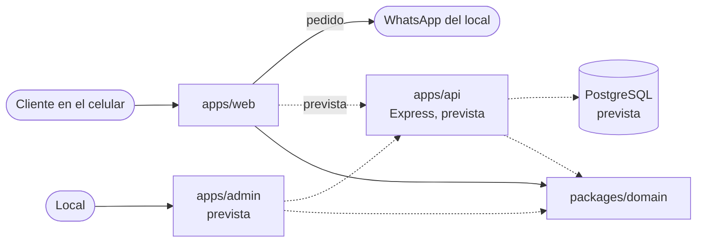

# Arquitectura

Vista general del proyecto y registro de las decisiones de arquitectura (ADR). Las partes marcadas como
**prevista** todavía no existen en el repositorio.

## Vista general

El repositorio es un monorepo con npm workspaces. Cada aplicación vive en `apps/` y el código compartido en
`packages/`.

| Parte             | Estado   | Qué hace |
|-------------------|----------|----------|
| `apps/web`        | Existe   | Web pública: carta, carrito, Arma tu pizza y checkout que envía el pedido por WhatsApp. Vite + React. Hoy es un sitio estático, sin backend. |
| `packages/domain` | Existe   | `@rys/domain`: reglas de negocio puras y sus tipos. Lo usan todas las apps. |
| `apps/api`        | Prevista | API en Express sobre PostgreSQL: carta, zonas e ingredientes desde la base, y validación de pedidos en el servidor con las mismas reglas que la web. |
| `apps/admin`      | Prevista | Panel para que el local edite precios, zonas e ingredientes a través de la API. |
| PostgreSQL        | Prevista | Base de datos de la API. La carta, las zonas y los ingredientes de hoy (`apps/web/src/data` y `docs/data`) pasan a ser su seed. |

### packages/domain

Paquete interno, sin paso de build: su `package.json` exporta `src/index.ts` y quien lo importa lo compila
(Vite en la web). Tiene:

- Precio de Arma tu pizza (`build-pizza.ts`).
- Líneas del pedido, reducer del carrito y totales (`cart.ts`).
- Validación del checkout (`checkout.ts`).
- Agrupación de zonas por costo de despacho (`delivery.ts`).
- Formato CLP y normalización del celular chileno (`format.ts`).
- Totales con despacho, mensaje del pedido y enlace de WhatsApp (`order-message.ts`).
- Búsqueda sin tildes (`search.ts`).
- Tipos del dominio (`types.ts`).

Reglas:

- **Solo lógica pura.** Nada de React, navegador, `localStorage`, variables de entorno ni Node. El tsconfig del
  código (`tsconfig.lib.json`) no incluye los tipos del DOM ni los de Node, así que usar `window` o `process` no
  compila.
- Lo que el local puede cambiar (precios, zonas, nombre, número) llega como argumento, nunca escrito en el paquete.
- Cada regla tiene tests en el mismo paquete, que corren en Node (Vitest, sin jsdom).
- Los imports internos llevan extensión `.ts`, para que la API pueda leer `src/` directamente con Node, que
  elimina los tipos sin compilar.

### Lo que se queda en apps/web

- `src/domain/cart-storage.ts` y `src/domain/sent-order.ts`: formato y validación de lo que se guarda en
  `localStorage`. Son funciones puras, pero solo tienen sentido en el navegador.
- `src/config/business.ts`: datos del local y lectura de las variables `VITE_*`.
- `src/data/`: la carta, las zonas y los ingredientes, hasta que pasen a la base.
- Componentes, contexto del carrito y hooks.

### Dependencias permitidas

- Las apps pueden importar paquetes de `packages/`. Un paquete nunca importa una app.
- Las apps no se importan entre sí: lo que necesiten dos apps va a un paquete.
- `packages/domain` no tiene dependencias de producción.

## Decisiones

### ADR-001: monorepo con npm workspaces

- **Estado:** aceptada
- **Fecha:** 2026-11-03

#### Contexto

La web de pedidos funciona sin backend: la carta está en el código y el pedido sale por WhatsApp. Lo siguiente es
una API en Express con PostgreSQL y un panel para que el local edite precios y zonas.

La API tiene que aplicar las mismas reglas que la web: precio de Arma tu pizza, validación del checkout,
normalización del celular, totales y mensaje del pedido. Si cada lado tiene su copia, tarde o temprano el precio
que ve el cliente y el que calcula el servidor dejan de coincidir.

El proyecto lo mantiene una sola persona, con un solo CI en GitHub Actions.

#### Opciones consideradas

1. **Monorepo con npm workspaces.** La web pasa a `apps/web`, la lógica pura a `packages/domain`, y la API y el
   panel se suman como `apps/api` y `apps/admin`.
   - A favor: una sola copia de las reglas de negocio, importada por todas las apps. Un cambio de regla y sus
     consumidores van en el mismo commit y pasan por el mismo CI. npm ya trae workspaces: no suma herramientas.
   - En contra: hay que mover la web y ajustar rutas, CI y documentación. Los scripts y el lockfile pasan a ser
     del monorepo.

2. **Repositorio aparte para la API.**
   - A favor: no toca la web. Despliegues e historiales independientes.
   - En contra: compartir el dominio obliga a publicarlo como paquete (registro privado o dependencia por git) y a
     versionarlo, o a copiarlo. Un cambio de regla pasa a ser dos PR en dos repos, coordinados a mano. Es mucho
     proceso para una persona.

3. **API en una carpeta sin mover el front** (por ejemplo `api/` junto a `src/`).
   - A favor: el cambio más chico hoy.
   - En contra: la web queda como la raíz y la API como un agregado, con configuraciones mezcladas (tsconfig,
     lint, Vitest, dependencias). La API terminaría importando `../src/domain` de la web, sin un límite claro de
     qué es compartido. Al llegar el panel, el problema se repite.

#### Decisión

Monorepo con npm workspaces (opción 1):

- `apps/web` con todo el front actual. `apps/api` y `apps/admin` se crean cuando corresponda.
- `packages/domain` (`@rys/domain`) con la lógica pura, como paquete interno sin build.
- `package.json` raíz privado, con `"workspaces": ["apps/*", "packages/*"]` y los scripts `dev`, `build`,
  `build:demo`, `lint`, `typecheck` y `test` delegando en los workspaces.
- Un solo `package-lock.json` en la raíz. Los archivos se mueven con `git mv` para conservar el historial.

No se suma Turborepo, Nx ni pnpm: con dos o tres workspaces, npm alcanza. Se reconsidera si el CI o los builds se
vuelven lentos.

#### Consecuencias

- Las reglas de negocio están en un solo lugar y la API las va a reutilizar tal cual.
- `packages/domain` no puede depender del navegador ni de Node: lo que dependa del entorno (guardado local,
  variables `VITE_*`) se queda en la app.
- Los comandos se corren desde la raíz (`npm run dev`, `npm test`…). Para uno solo:
  `npm run <script> --workspace apps/web`.
- Vite lee los archivos de entorno desde `apps/web` (`.env`, `.env.local`, `.env.demo`), no desde la raíz.
- Las salidas de build quedan en `apps/web/dist` y `apps/web/dist-demo`.
- Como el dominio no tiene build, cada app que lo use debe poder compilar TypeScript: Vite en la web, y en la API
  Node con eliminación de tipos o una herramienta equivalente. Si alguna vez se necesita publicarlo o consumirlo
  desde JavaScript compilado, habrá que agregarle un paso de build.
- El CI sigue siendo uno solo y corre lint, typecheck, tests y builds de todos los workspaces.
