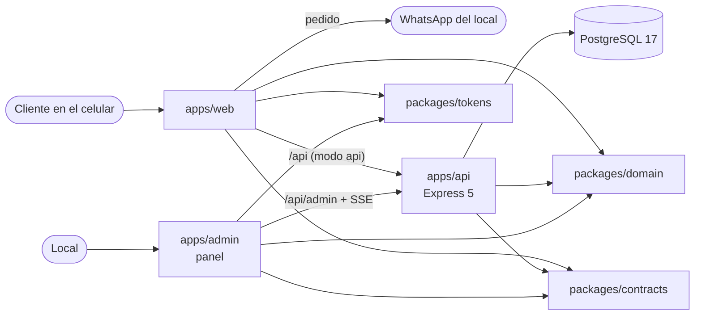

# Arquitectura

Vista general del proyecto y registro de las decisiones de arquitectura (ADR). Las partes marcadas como
**prevista** todavía no existen en el repositorio.

## Vista general

El repositorio es un monorepo con npm workspaces. Cada aplicación vive en `apps/` y el código compartido en
`packages/`.



| Parte                | Estado   | Qué hace |
|----------------------|----------|----------|
| `apps/web`           | Existe   | Web pública: carta, carrito, Arma tu pizza y checkout. Vite + React. Con `VITE_DATA_SOURCE=static` usa la carta del bundle y manda el pedido directo a WhatsApp; con `api`, pide la carta a la API, crea el pedido ahí y el cliente lo envía por WhatsApp con su código. |
| `packages/domain`    | Existe   | `@rys/domain`: reglas de negocio puras y sus tipos (precios, carrito, checkout, mensaje, horario, estados del pedido). Lo usan todas las apps. |
| `packages/contracts` | Existe   | `@rys/contracts`: esquemas Zod de requests, responses y errores de la API, con sus tipos inferidos. |
| `apps/api`           | Existe   | `@rys/api`: API en Express 5 sobre PostgreSQL con Drizzle: `GET /health`, `GET /api/menu`, `POST /api/orders` y, para el panel, sesión con cookie, pedidos y SSE, y gestión de carta, zonas y ajustes con permisos por rol en `/api/admin` (OpenAPI en `/api/docs` en desarrollo). |
| `apps/admin`         | Existe   | `@rys/admin`: panel del local (Vite + React, puerto 5174): login, pedidos en vivo por SSE y gestión de la carta, ingredientes, zonas y ajustes (pausa, horario, datos del local y precios de Arma tu pizza). |
| `packages/tokens`    | Existe   | `@rys/tokens`: solo CSS. Colores, tipografías, la utilidad `display`, el foco visible y el movimiento reducido de la marca, para la web y el panel (ADR-005). |
| PostgreSQL           | Existe   | PostgreSQL 17 en Docker Compose (`docker-compose.yml` en la raíz), con las bases `rys` (desarrollo) y `rys_test` (tests). La carta de `docs/data` es su seed. |

El detalle de qué construye cada fase está en `docs/BACKEND-SPEC.md` y `docs/PLAN-BACKEND.md`.

### apps/api

Capas, de afuera hacia adentro (ADR-002):

```
routes/ → controllers/ → services/ → repositories/ → db/ (Drizzle)
```

- Un controlador nunca toca la base; un servicio nunca recibe `req`/`res`; un repositorio no tiene reglas de
  negocio. Las reglas puras se importan de `@rys/domain`.
- `container.ts` arma repositorios y servicios a mano (inyección por constructor). `app.ts` exporta
  `createApp(deps)`, que los tests usan con supertest sin abrir un puerto.
- `config/env.ts` valida las variables con Zod al arrancar: si falta algo, la API no arranca.
- Corre con `tsx` (desarrollo y demo), que también lee `@rys/domain` y `@rys/contracts` desde `src/`.
- Módulos: `catalog` (menú y gestión de productos, variantes e ingredientes), `orders`, `delivery` (zonas),
  `settings` y `auth`. Los permisos por rol de toda una ruta van en `routes/` (`requireRole`); los que dependen
  del campo (caja solo cambia la disponibilidad y la pausa) los revisa el servicio con `services/permissions.ts`.

### apps/admin

```
src/api/          cliente de /api/admin y /api/menu (respuestas validadas con @rys/contracts) y el SSE
src/router/       router mínimo con la History API (sin librería)
src/pages/        una página por ruta: login, pedidos, detalle, carta, ingredientes, zonas y ajustes
src/components/   piezas genéricas (interruptor, campo, diálogo de confirmación) y la lista con precio editable
src/lib/          lógica pura del tablero y de los formularios (precios, horario), con tests
src/test/         API y EventSource de mentira, con los mismos esquemas y permisos que la API
```

### packages/contracts

Igual que `@rys/domain`, sin paso de build: exporta `src/index.ts`. Declara `"sideEffects": false` para que Vite deje
Zod fuera de la web estática, que no lo usa. Depende solo de Zod y de `@rys/domain` (de ahí
toma los mensajes del checkout, los estados del pedido y el normalizador del celular). La API valida con
estos esquemas lo que entra y lo que sale; la web y el panel los usan para tipar sus llamadas.

### packages/domain

Paquete interno, sin paso de build: su `package.json` exporta `src/index.ts` y quien lo importa lo compila
(Vite en la web). Tiene:

- Precio de Arma tu pizza (`build-pizza.ts`).
- Líneas del pedido, reducer del carrito y totales (`cart.ts`).
- Validación del checkout (`checkout.ts`).
- Agrupación de zonas por costo de despacho (`delivery.ts`).
- Formato CLP y normalización del celular chileno (`format.ts`).
- Totales con despacho, mensaje del pedido y enlace de WhatsApp (`order-message.ts`).
- Horario del local en America/Santiago: `isOpenAt`, `nextOpening` y `orderingStatus` (`opening-hours.ts`).
- Estados del pedido y su tabla de transiciones (`order-status.ts`).
- Cotización del pedido completo y disponibilidad de cada línea (`order-quote.ts`): la usan la API para recalcular
  y la web para marcar lo agotado.
- Búsqueda sin tildes (`search.ts`).
- Tipos del dominio (`types.ts`).

Reglas:

- **Solo lógica pura.** Nada de React, navegador, `localStorage`, variables de entorno ni Node. El tsconfig del
  código (`tsconfig.lib.json`) no incluye los tipos del DOM ni los de Node, así que usar `window` o `process` no
  compila.
- Lo que el local puede cambiar (precios, zonas, nombre, número) llega como argumento, nunca escrito en el paquete.
- Cada regla tiene tests en el mismo paquete, que corren en Node (Vitest, sin jsdom).
- Los imports internos llevan extensión `.ts`, para que la API pueda leer `src/` directamente con Node, que
  elimina los tipos sin compilar.

### Lo que se queda en apps/web

- `src/domain/cart-storage.ts` y `src/domain/sent-order.ts`: formato y validación de lo que se guarda en
  `localStorage`. Son funciones puras, pero solo tienen sentido en el navegador.
- `src/config/business.ts`: lee los datos del local de `docs/data/business.json` (la misma fuente que el seed de la
  API) y las variables `VITE_*`.
- `src/data/`: la carta, las zonas y los ingredientes del modo static (la web publicada y `build:demo`).
- `src/data-source/`: de dónde sale la carta y a dónde va el pedido. `CatalogSource` y `OrderGateway`, cada uno con
  una implementación `static` y otra `api`, elegidas con `VITE_DATA_SOURCE`. `MenuData` es la carta con la forma
  de `@rys/domain` más el estado del local; `src/domain/menu-adapter.ts` la arma desde `GET /api/menu`.
- `src/store/MenuProvider.tsx`: carga la carta (esqueleto, error con "Reintentar") y la vuelve a pedir al volver a la
  pestaña y a la hora de abrir. `CartProvider` arma el pedido con esa carta y lo vuelve a valorizar si cambia.
- Componentes, contexto del carrito y hooks.

### Dependencias permitidas

- Las apps pueden importar paquetes de `packages/`. Un paquete nunca importa una app.
- Las apps no se importan entre sí: lo que necesiten dos apps va a un paquete.
- `packages/domain` no tiene dependencias de producción. `packages/contracts` depende solo de Zod y de
  `@rys/domain`.

## Decisiones

### ADR-001: monorepo con npm workspaces

- **Estado:** aceptada
- **Fecha:** 2026-11-03

#### Contexto

La web de pedidos funciona sin backend: la carta está en el código y el pedido sale por WhatsApp. Lo siguiente es
una API en Express con PostgreSQL y un panel para que el local edite precios y zonas.

La API tiene que aplicar las mismas reglas que la web: precio de Arma tu pizza, validación del checkout,
normalización del celular, totales y mensaje del pedido. Si cada lado tiene su copia, tarde o temprano el precio
que ve el cliente y el que calcula el servidor dejan de coincidir.

El proyecto lo mantiene una sola persona, con un solo CI en GitHub Actions.

#### Opciones consideradas

1. **Monorepo con npm workspaces.** La web pasa a `apps/web`, la lógica pura a `packages/domain`, y la API y el
   panel se suman como `apps/api` y `apps/admin`.
   - A favor: una sola copia de las reglas de negocio, importada por todas las apps. Un cambio de regla y sus
     consumidores van en el mismo commit y pasan por el mismo CI. npm ya trae workspaces: no suma herramientas.
   - En contra: hay que mover la web y ajustar rutas, CI y documentación. Los scripts y el lockfile pasan a ser
     del monorepo.

2. **Repositorio aparte para la API.**
   - A favor: no toca la web. Despliegues e historiales independientes.
   - En contra: compartir el dominio obliga a publicarlo como paquete (registro privado o dependencia por git) y a
     versionarlo, o a copiarlo. Un cambio de regla pasa a ser dos PR en dos repos, coordinados a mano. Es mucho
     proceso para una persona.

3. **API en una carpeta sin mover el front** (por ejemplo `api/` junto a `src/`).
   - A favor: el cambio más chico hoy.
   - En contra: la web queda como la raíz y la API como un agregado, con configuraciones mezcladas (tsconfig,
     lint, Vitest, dependencias). La API terminaría importando `../src/domain` de la web, sin un límite claro de
     qué es compartido. Al llegar el panel, el problema se repite.

#### Decisión

Monorepo con npm workspaces (opción 1):

- `apps/web` con todo el front actual. `apps/api` y `apps/admin` se crean cuando corresponda.
- `packages/domain` (`@rys/domain`) con la lógica pura, como paquete interno sin build.
- `package.json` raíz privado, con `"workspaces": ["apps/*", "packages/*"]` y los scripts `dev`, `build`,
  `build:demo`, `lint`, `typecheck` y `test` delegando en los workspaces.
- Un solo `package-lock.json` en la raíz. Los archivos se mueven con `git mv` para conservar el historial.

No se suma Turborepo, Nx ni pnpm: con dos o tres workspaces, npm alcanza. Se reconsidera si el CI o los builds se
vuelven lentos.

#### Consecuencias

- Las reglas de negocio están en un solo lugar y la API las va a reutilizar tal cual.
- `packages/domain` no puede depender del navegador ni de Node: lo que dependa del entorno (guardado local,
  variables `VITE_*`) se queda en la app.
- Los comandos se corren desde la raíz (`npm run dev`, `npm test`…). Para uno solo:
  `npm run <script> --workspace apps/web`.
- Vite lee los archivos de entorno desde `apps/web` (`.env`, `.env.local`, `.env.demo`), no desde la raíz.
- Las salidas de build quedan en `apps/web/dist` y `apps/web/dist-demo`.
- Como el dominio no tiene build, cada app que lo use debe poder compilar TypeScript: Vite en la web, y en la API
  Node con eliminación de tipos o una herramienta equivalente. Si alguna vez se necesita publicarlo o consumirlo
  desde JavaScript compilado, habrá que agregarle un paso de build.
- El CI sigue siendo uno solo y corre lint, typecheck, tests y builds de todos los workspaces.

### ADR-002: Express 5 con capas MVC, servicios y repositorios

- **Estado:** aceptada
- **Fecha:** 2026-11-03

#### Contexto

La API es pequeña (5 módulos: `catalog`, `orders`, `delivery`, `settings`, `auth`) y la mantiene una sola persona
que ya trabaja con Express y con esta separación en otros proyectos.

#### Opciones consideradas

1. Express 5.
2. Fastify.
3. NestJS.

#### Decisión

Express 5 con rutas → controladores → servicios → repositorios, validación con un middleware Zod e inyección por
constructor armada a mano en `container.ts`.

#### Consecuencias

- Curva de aprendizaje nula y código explícito.
- Express no valida ni documenta por sí solo: lo cubren los esquemas de `packages/contracts` (validación) y la
  generación de OpenAPI desde esos mismos esquemas.
- NestJS se descarta por ser demasiada estructura para este tamaño.

### ADR-003: PostgreSQL con Drizzle

- **Estado:** aceptada
- **Fecha:** 2026-11-03

#### Contexto

Datos relacionales (catálogo, pedidos con líneas, historial), necesidad de transacciones y de migraciones
versionadas.

#### Opciones consideradas

1. Drizzle.
2. Prisma.
3. `pg` con SQL a mano.

#### Decisión

PostgreSQL 17 (Docker en desarrollo) con Drizzle ORM y migraciones SQL generadas por drizzle-kit y guardadas en
git.

#### Consecuencias

- SQL tipado sin capa de "magia", migraciones legibles y revisables, sin motor binario aparte.
- Drizzle se usa solo dentro de los repositorios, así que cambiarlo afectaría una sola capa.

### ADR-004: Sesiones con cookie en vez de JWT

- **Estado:** aceptada
- **Fecha:** 2026-11-03

#### Contexto

El panel lo usan 2 o 3 personas del local desde el mismo origen que la API (proxy en desarrollo).

#### Opciones consideradas

1. JWT en `localStorage`.
2. JWT en cookie.
3. Sesión opaca en cookie con tabla de sesiones.

#### Decisión

Token opaco aleatorio en cookie `HttpOnly` + `SameSite=Lax`, con su hash SHA-256 en la tabla `sessions`.
Protección CSRF validando el header `Origin` en las mutaciones.

#### Consecuencias

- El token no es accesible desde JavaScript, el logout y la desactivación de usuarios son inmediatos (se borra la
  fila) y no hay que manejar rotación de claves ni refresh tokens.
- A cambio, cada request del panel consulta la tabla de sesiones, lo que a esta escala no importa.

### ADR-005: Panel como app separada

- **Estado:** aceptada
- **Fecha:** 2026-11-03

#### Contexto

La carta pública tiene Lighthouse 100 y un bundle pequeño; el panel tiene otras dependencias, otro público y otra
forma de uso.

#### Opciones consideradas

1. Rutas `/admin` dentro de `apps/web`.
2. App separada `apps/admin`.

#### Decisión

App separada con su propio build, compartiendo tokens de diseño, `@rys/domain` y `@rys/contracts`.

#### Consecuencias

- El cliente nunca descarga código del panel y cada app evoluciona sin afectar a la otra.
- Hay un segundo `vite.config.ts` y un segundo puerto en desarrollo.

### ADR-006: Contratos compartidos con Zod

- **Estado:** aceptada
- **Fecha:** 2026-11-03

#### Contexto

La web, el panel y la API deben estar de acuerdo en la forma de cada request y response.

#### Opciones consideradas

1. Tipos TypeScript duplicados.
2. OpenAPI como fuente, con generación de clientes.
3. Esquemas Zod compartidos.

#### Decisión

Paquete `packages/contracts` con los esquemas Zod y sus tipos inferidos. La API valida con ellos, los clientes los
usan para tipar y, cuando conviene, para validar respuestas. La documentación OpenAPI se genera desde ellos.

#### Consecuencias

- Un cambio de contrato rompe el typecheck de quien no se adaptó, en el mismo commit.
- Zod queda como dependencia de los tres consumidores. `@rys/domain` sigue sin dependencias externas.

### ADR-007: Tiempo real con SSE y bus en memoria

- **Estado:** aceptada
- **Fecha:** 2026-11-03

#### Contexto

El panel debe ver los pedidos nuevos al instante. Solo el servidor emite; el panel no necesita enviar mensajes por
el mismo canal.

#### Opciones consideradas

1. Polling.
2. WebSockets.
3. Server-Sent Events.

#### Decisión

SSE (`GET /api/admin/orders/stream`) alimentado por un `EventEmitter` en memoria, con heartbeat y recarga de la
lista al reconectar.

#### Consecuencias

- HTTP simple, la cookie de sesión funciona igual, reconexión automática del navegador y cero dependencias.
- Funciona mientras haya una sola instancia de la API; si algún día hay más, el bus pasa a `LISTEN/NOTIFY` de
  PostgreSQL sin cambiar el contrato con el panel.

### ADR-008: Precio calculado en el servidor y pedidos idempotentes

- **Estado:** aceptada
- **Fecha:** 2026-11-03

#### Contexto

En la v1 el precio se calculaba solo en el navegador, y el pedido podía reenviarse por recargas o dobles clics.

#### Decisión

El cliente envía solo productos, variantes, ingredientes y cantidades, más el total que vio. La API recalcula con
`@rys/domain` (el mismo código de la web), rechaza con `PRICE_CHANGED` si no coincide y guarda snapshots de
precios y nombres en el pedido. Toda creación exige `Idempotency-Key`, única en la tabla `orders` junto con el
hash del body.

#### Consecuencias

- Un precio manipulado en el navegador no tiene efecto, un pedido nunca cambia aunque cambie la carta y un
  reintento por red inestable no crea duplicados.
- El cliente debe manejar `PRICE_CHANGED` mostrando los precios nuevos.
